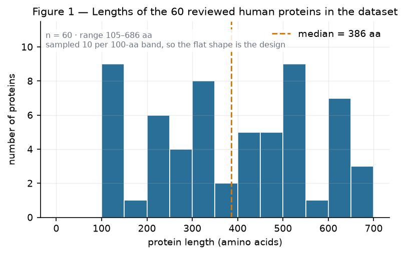

# Python Foundations for the Life Sciences

**CLS-Open repository 1 of 15 — the beginner entry point.**

You will learn Python by doing a job that matters: read real protein records from
UniProt, compute what they contain, find the defects that real files really have, and
produce a report a collaborator can re-run.

By the end of Modules 1–3 you can build a small, tested, documented Python package with
a command-line interface and explain every design decision in it.

## Start here

1. **[Installation](installation.md)** — 10 minutes, ends with `seqreport --version`
   printing `0.1.0`.
2. **[Prerequisites](prerequisites.md)** — what you need to know, and what you do not.
3. **[Learning path](learning_path.md)** — the order, the time budget, and where to stop
   if you only have a weekend.
4. **[Module 1](modules/01-environment-and-jupyter.md)** — your environment, your
   evidence.

## What is here

| Section | What it is |
|---|---|
| [Modules](modules/01-environment-and-jupyter.md) | Three complete 13-part lessons |
| [Practicals](practicals/practical-01-setup-and-first-report.md) | Five guided sessions with rubrics |
| [Assessments](assessments/quiz-01-modules-1-3.md) | 3 assignments, 2 challenges, quiz + answer key |
| [Projects](https://github.com/cls-open/python-for-biologists/blob/main/projects/mini_projects/README.md) | Mini-project (4–6 h) and capstone (20–25 h) |
| [Instructor pack](instructor/teaching-plans.md) | Delivery plans, marking, integrity policy |
| [Validation](validation.md) | Exactly what has been checked, and against what |
| [Limitations](limitations.md) | What this repository does **not** do |
| [References](references.md) | Every citation, DOI-verified |
| [Roadmap](roadmap.md) | What Modules 4–8 will contain, and when |

## Figures

*Figure 1 — Lengths of the 60 reviewed human proteins in `datasets/sample/`. The sample is
**stratified by design** (10 proteins per 100-aa length band), so the flat shape is the
sampling, not a biological finding. Median 386 aa. Regenerated from data by
`scripts/make_figures.py`; the same figure is produced in Module 2.*

The other three figures — composition of the cytochrome c orthologues, k-mer similarity
against human cytochrome c, and a check that the QC rules do not fire on clean data —
are in [`figures/`](https://github.com/cls-open/python-for-biologists/tree/main/figures)
and are used in Module 2, Module 3 and Practical 02 respectively.

## Honest status

v0.1.0 ships **three of eight modules**. Modules 4–8 are specified in the
[roadmap](roadmap.md) with their datasets, exercises and validation plans, and are not
written. That is stated here, in the README, and in the roadmap, because a course that
pretends to be finished is worse than a course that says where it stops.

## Licence

Content **CC BY 4.0**, code **MIT**. Data: UniProt, CC BY 4.0, retrieved 2026-11-06.
